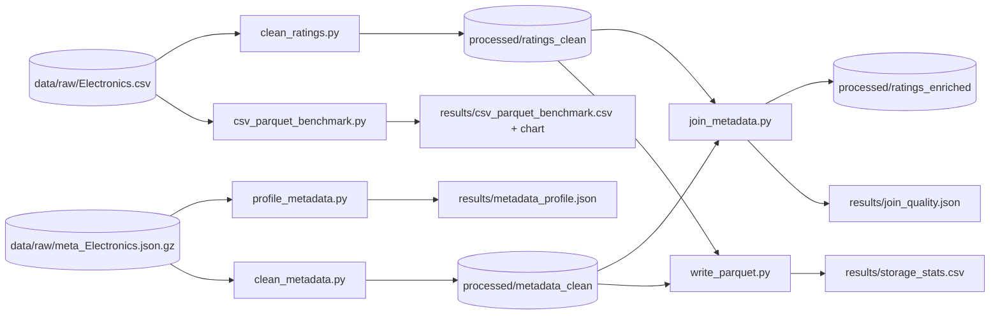

# Amazon Electronics — ETL (ratings + metadata)

Pipeline Spark làm sạch **ratings** (CSV) và **metadata** (JSON Lines), ghi ra Parquet, rồi kiểm tra chất lượng và độ phủ khi join. Tương ứng Epic E3 (T10–T15) trong `ChiaTicket.docx`.

## Luồng dữ liệu



## Chạy theo thứ tự (từ thư mục gốc repo)

```bash
python src/etl/read_ratings.py       --input data/raw/Electronics.csv --show 10   # T10: kiểm tra đọc đúng cột
python src/etl/clean_ratings.py      --input data/raw/Electronics.csv             # T11
python src/etl/profile_metadata.py   --input data/raw/meta_Electronics.json.gz    # T06
python src/etl/clean_metadata.py     --input data/raw/meta_Electronics.json.gz    # T12
python src/etl/write_parquet.py      --raw-ratings data/raw/Electronics.csv \
                                     --raw-metadata data/raw/meta_Electronics.json.gz   # T13: kiểm tra Parquet
python src/etl/join_metadata.py                                                    # T14
python src/etl/csv_parquet_benchmark.py --csv data/raw/Electronics.csv --repeats 3 # T15 (tùy chọn)
```

Thử nhanh trên một phần dữ liệu: thêm `--limit 200000` cho `read_ratings.py` / `clean_ratings.py`.

## Các file và quan hệ giữa chúng

| File | Vai trò | Dùng / được dùng bởi |
|---|---|---|
| `src/common/spark_utils.py` | `get_spark`, `read_parquet`, `write_parquet` (có đường dự phòng khi Spark lỗi Hadoop trên Windows), `storage_level` | **Mọi script** |
| `src/etl/metadata_fields.py` | **Nơi duy nhất khai báo trường metadata** (`FIELDS`) và luật làm sạch (gồm brand) | `read_metadata`, `clean_metadata`, `profile_metadata`, `write_parquet` |
| `src/etl/read_metadata.py` | Schema đọc JSON, sinh tự động từ `FIELDS` | `clean_metadata`, `profile_metadata` |
| `src/etl/read_ratings.py` | Schema đọc ratings CSV (tự nhận diện header) | `clean_ratings`, `csv_parquet_benchmark` |
| `src/etl/clean_ratings.py` | 6 quy tắc làm sạch, ghi `ratings_quality.csv` | → `ratings_clean` |
| `src/etl/clean_metadata.py` | Làm sạch, xử lý null/duplicate (brand), khử trùng ASIN | → `metadata_clean` + 3 báo cáo |
| `src/etl/profile_metadata.py` | Đo chất lượng metadata **trước** khi clean (gồm gợi ý chỉnh luật brand) | độc lập |
| `src/etl/write_parquet.py` | **Đọc ngược** Parquet đã ghi: số dòng, schema, khóa duy nhất, dung lượng | sau `clean_*` |
| `src/etl/join_metadata.py` | Left join ratings ← metadata, báo cáo coverage, ghi `ratings_enriched` | sau `clean_*` |
| `src/etl/csv_parquet_benchmark.py` | So sánh CSV và Parquet trên cùng workload | độc lập (tùy chọn) |
| `scripts/peek_jsonl.py` | Xem nhanh kiểu dữ liệu của file JSONL trước khi thêm trường | công cụ phụ |
| `tests/` | Test bằng dữ liệu mô phỏng nhỏ | — |

Luồng phụ thuộc chính: `metadata_fields` → (`read_metadata`) → `clean_metadata` → `metadata_clean`; `read_ratings` → `clean_ratings` → `ratings_clean`; hai thư mục này cùng đi vào `join_metadata` và `write_parquet`.

## Thêm / sửa một trường metadata

Chỉ sửa danh sách `FIELDS` trong `src/etl/metadata_fields.py` (ví dụ `FieldSpec("date")`); đọc, clean, profile, kiểm tra schema và bảng join tự áp dụng. Xem ví dụ trong docstring đầu file. **Sau khi đổi `FIELDS`, chạy lại** `clean_metadata.py` → `write_parquet.py` → `join_metadata.py` vì schema Parquet đã đổi.

## Biến môi trường (máy ít RAM)

| Biến | Ý nghĩa | Ví dụ |
|---|---|---|
| `SPARK_DRIVER_MEMORY` | Bộ nhớ JVM (viết `8g`, không viết `8gb`) | `8g` |
| `SPARK_MASTER` | Số core song song | `local[4]` |
| `SPARK_STORAGE_LEVEL` | Nơi cache bước trung gian: `MEMORY_AND_DISK` (mặc định) hoặc `DISK_ONLY` | `DISK_ONLY` |

PowerShell: `$env:SPARK_DRIVER_MEMORY = "8g"` (đặt trước khi chạy `python`). Giá trị sai định dạng sẽ được báo lỗi rõ ràng.

## Lưu ý

- `ratings_enriched` được ghi bằng **pyarrow theo từng batch** (mặc định), không qua Spark, nên ít tốn RAM và không cần Hadoop/winutils. Dùng `--writer spark` nếu chạy trên Linux/WSL2/GCP.
- Nếu Spark ghi Parquet lỗi trên Windows, `write_parquet` tự chuyển sang pandas/pyarrow (`--writer auto`); cột `writer_detected` trong `storage_stats.csv` cho biết thư mục Parquet nào đã được ghi bằng cách nào.
- Chạy test: `pytest tests -q`.
